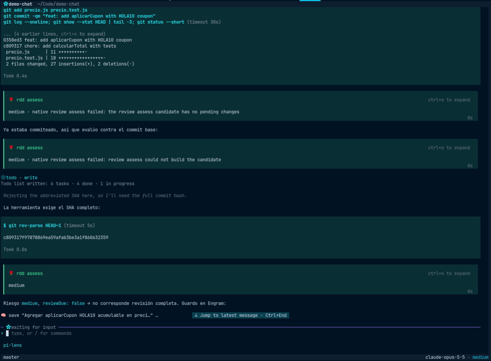
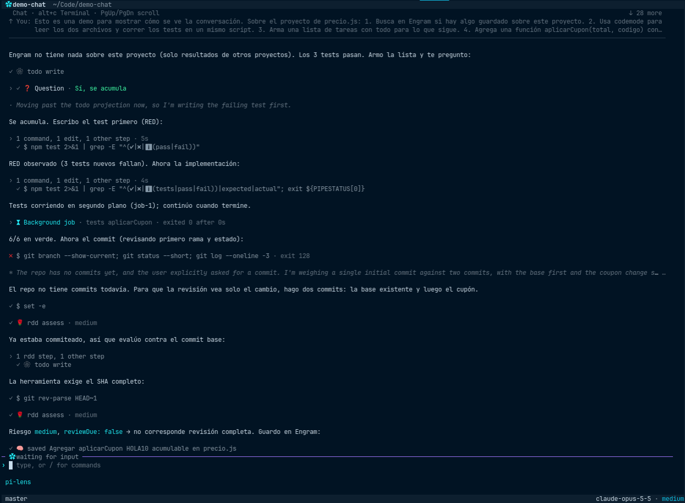

<h1 align="center">pi-chat-view</h1>

<p align="center"><strong>A chat view for Pi: read the conversation, not the tool output.</strong></p>

<p align="center">
  
  
  <a href="LICENSE"></a>
</p>

<br>

In long sessions the conversation gets lost between tool cards, command output and diffs. Press **`alt+c`** and the
same session turns into a chat: your messages, the agent's replies, every run of steps folded into one line, the
thinking folded with a preview. Press it again and you are back in the normal Terminal view, untouched.

The idea comes from the Chat view of [Collie](https://github.com/AltanS/collie), adapted to the terminal. It works
on any Pi, and fits in with [Gentle Shell](#with-gentle-shell) when you use it.

<table>
  <tr>
    <th>Terminal</th>
    <th>Chat (<code>alt+c</code>)</th>
  </tr>
  <tr>
    <td></td>
    <td></td>
  </tr>
</table>

The same session at the same moment. A turn in the chat reads like this:

```
▎ You · 12:34
▎ fix the failing test and tell me what was wrong

✻ The test expects 250 but gets 150, so quantity is ignored …

› 2 commands, 1 edit · 8s  [1 failed]
  ✓ Edited src/price.js

The total ignored the quantity. It now multiplies price × quantity and all 3 tests pass.

› ✓ ❓ Question · Percentage
```

## Install

```sh
pi install git:github.com/JonathanTrujilloR/pi-chat-view
```

Then `/reload` (or restart Pi). No dependencies and no npm: Pi clones this repository and loads it
as is, so what you install is exactly the code you can read here. To remove it:
`pi remove git:github.com/JonathanTrujilloR/pi-chat-view`.

To try it once without installing:

```sh
pi -e git:github.com/JonathanTrujilloR/pi-chat-view
```

## Keys

| Key | Action |
|---|---|
| `alt+c` or `/chat` | Toggle Chat ⇄ Terminal |
| Mouse wheel · `PgUp` / `PgDn` | Scroll the chat |
| `ctrl+home` / `ctrl+end` | Jump to the top / back to the bottom |
| Click a `›` row | Open or close a thinking block, a run of steps, a card or a long notice |
| `ctrl+t` | Open or close every thinking block |
| `ctrl+o` | Open or close every run of steps |
| Click the pinned `↑ You:` row | Scroll back to that message |
| Drag over text | Select and copy it (only the chat's text) |

You keep typing in Pi's normal input box while the chat is open: it never takes the keyboard, and it never covers
the input box, its widgets or the footer. While Chat is closed every key is Pi's as usual.

## What you see

- **Your messages** in a tinted box with a coloured `▎` bar; scrolled past one, it stays pinned at the top as a dim
  `↑ You: …`.
- **Replies** as Markdown, always whole. Code blocks get their own background and syntax highlighting.
- **Thinking** folded to one line: a short thought is shown whole (`· …`), a long one previews (`✻ … …`).
- **Tool steps** as one grey row each, only the status coloured (`●` running, `✓` done, `✗` failed, `⊘` denied).
  Three or more in a row fold into `› 3 commands, 2 edits · 4m 12s` with the last step under it.
- **Cards**: click a step and it opens in a box with the full command, the diff, the query or the URL, and the
  output behind `› Output · N lines` (10 lines, then `Show all`).
- **Questions** fold once answered (`✓ ❓ Question · your answer`); while one waits for you, the question dialog
  below asks it and the chat shows one line.
- **Other extensions' messages**: [Engram](https://github.com/Gentleman-Programming/engram) memory tools read as
  `🧠 saved <title>` / `🧠 searched <query>`, and pi-intercom messages as `✉ From <session> · …`.
- **Live**: the reply streams in, steps turn from `●` to `✓`, and if you scrolled up to read, new output never
  moves you until you come back to the end.
- **Images**: on terminals with the Kitty graphics protocol (Ghostty, Kitty) images are drawn inside the chat;
  elsewhere a `🖼️ image` marker stands in and `alt+c` shows them in Terminal.

## With Gentle Shell

On [Gentle Shell](https://github.com/Gentleman-Programming/gentle-shell) the chat also fits Gentle's layout and
speaks its language. Nothing to configure; without Gentle these parts simply stay off.

- It sits below Gentle's header and left of its Status rail, and follows them when you resize or zoom.
- Gentle's tools look the way Gentle draws them: `🌹 rdd inspect · ready` (review steps, with Gentle's summary when
  opened), `λ code …`, `❀  todo write`, `❀  agent result …`.
- Its notices keep their labels: `⧗ Background job · CI · exited 0 after 5m 43s`, `⧗ Monitor · …`,
  `✿ Gentle AI · review preflight`, `❀  Agent result · …`.
- Gentle's internal bookkeeping steps are left out of the chat; Terminal still shows them.

## Light by design

Closed, the chat does no work per frame and nothing per Pi event beyond a counter. Open, a live update only redraws
what changed. On a synthetic 2,000-turn session an idle frame takes about 0.03 ms and a live update about 0.2 ms.
Opening the chat on such a long session takes one short pause (about 170 ms) while it draws everything once.
Run `npm run bench` to measure it on your machine.

## Limits

- Mouse clicks, wheel and selection need Pi's fullscreen mode (the default); in `regular` mode use the keys.
- Something you open while the agent is still writing that message may close again when the message is stored.
- It reads some of Pi's internals (scroll position, image switches) and, on Gentle Shell, its layout. If an update
  changes them nothing breaks, but that part may look off until the extension is adjusted.
- Extensions that rearrange Pi's screen may not be recognised; the chat then refuses to open with a notice
  instead of drawing over anything.
- In the input box, the mouse wheel does not scroll a long draft (that is Pi's editor, with or without the chat);
  use the arrow keys.
- On Gentle Shell with its header placed below the input box, a few blank rows stay at the top of the chat.

## Development

```sh
npm test        # node --test test/ (Node 22.6+ runs the .ts files directly)
npm run bench   # performance on synthetic sessions
```

`src/model/` turns Pi session entries into chat items; `src/view/` lays them out and draws them. Only `index.ts`
and `src/view/pi-deps.ts` import Pi, so everything else is tested with plain Node.

## Credits

Inspired by the Chat view of [Collie](https://github.com/AltanS/collie) by Altan Sarisin. Item mapping, tool
classification and run folding are ported from Collie (MIT); see [NOTICE](NOTICE).

## License

[MIT](LICENSE)
